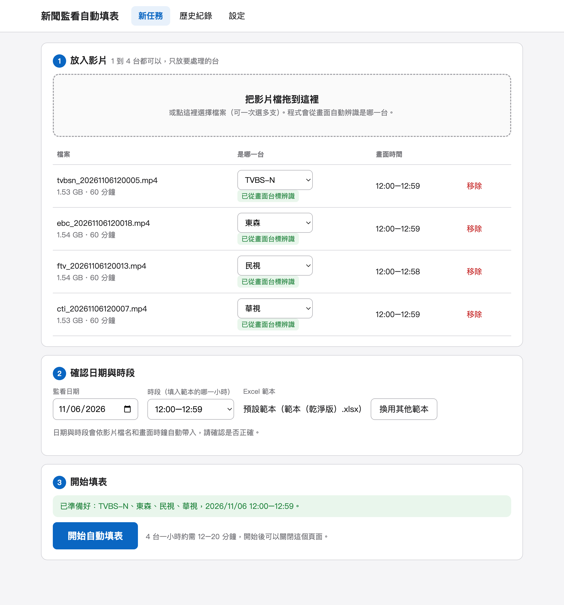
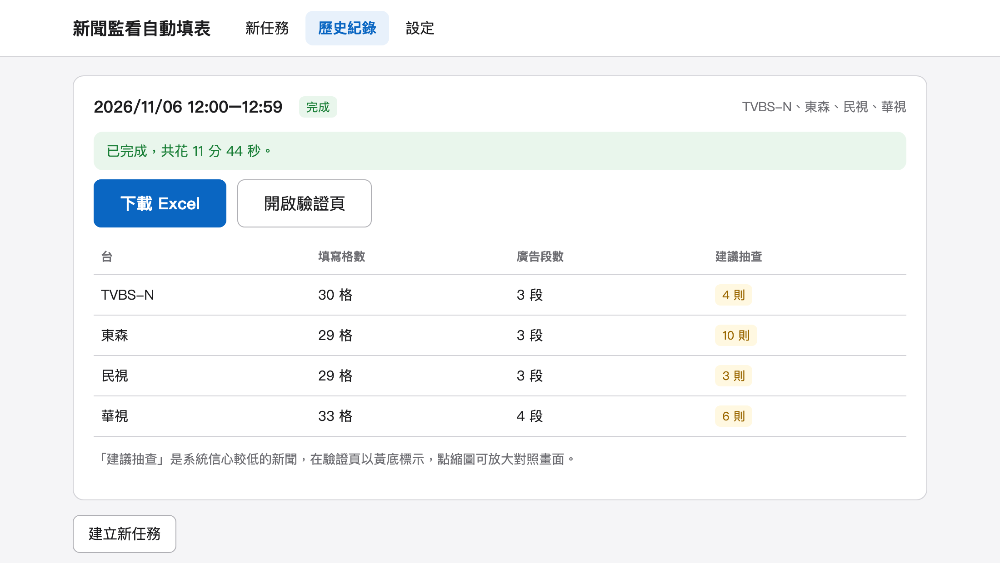
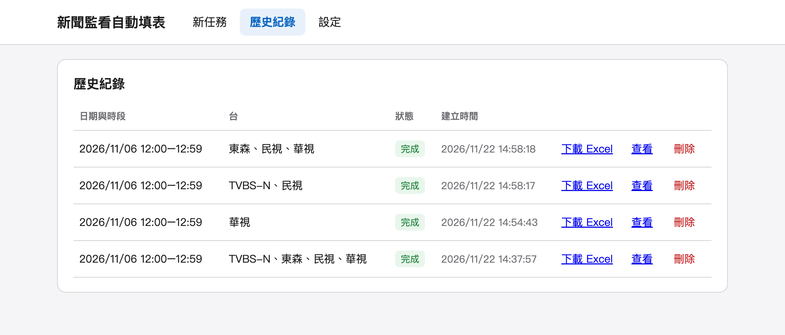
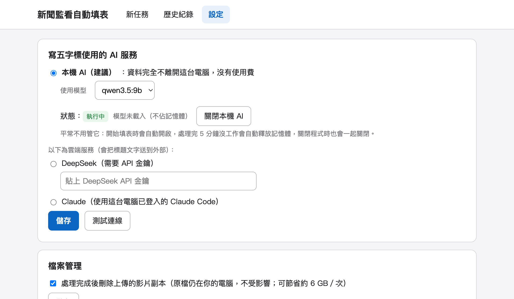

# 新聞監看自動填表（news-monitor-autofill）

把電視新聞側錄影片丟進去，自動辨識每一則新聞、寫好「五字標」，並填進監看表 Excel。
取代實習生「一人盯四台、逐分鐘手打五字標」的工作，人只需要每小時花約 10 分鐘抽查。

> UNEXT AI 企業創新實戰營　企業命題：三立新聞台「新聞監看全自動填表」

## 畫面

| 1. 放入影片，自動認台、帶入日期與時段 | 2. 完成後下載 Excel、開啟驗證頁 |
|---|---|
|  |  |

| 3. 歷史紀錄，可重新下載 | 4. 設定：選擇本機 AI 或雲端 AI |
|---|---|
|  |  |

## 使用條件

| 項目 | 條件 |
|---|---|
| 電腦 | **Mac（Apple 晶片 M1 以上）**。文字辨識使用 macOS 內建的 Apple Vision，Windows／Intel Mac 無法執行。 |
| 記憶體 | 16 GB 以上；**要用本機 AI 建議 32 GB**。 |
| 硬碟 | 每次任務暫存「影片大小 × 1.5」（四台一小時約 6 GB，完成後可自動刪除副本）；本機 AI 模型另需 7–19 GB。 |
| 作業系統／軟體 | macOS＋Python 3（第一次開啟時自動安裝所需套件）。本機 AI 需另裝 [Ollama](https://ollama.com)（`brew install ollama`）。 |
| 實測環境 | MacBook Pro M5、32 GB、macOS 27.2、Python 3.14、Ollama 0.40.17。 |
| 影片 | 一支影片＝一台，**1 到 4 台都可以**；mp4／mov／ts／mkv，任何解析度（自動縮成 1280×720）。畫面需有台標與左下角時鐘（用來認台與對時）。 |
| 支援頻道 | TVBS-N、東森、民視、華視，**2026 年 11 月的畫面版面**。電視台改版時要更新 `pipeline/config.py` 的讀取區域。 |
| 監看表範本 | Excel 第一個工作表：A 欄為時間（1200、1201…），表頭列有台名（TVBS、東森、民視、華視）。可在網頁上傳自己的範本。 |
| 網路 | 安裝時需要。**使用本機 AI 時，處理過程完全不需要網路**，影片與文字都不會離開這台電腦。 |
| 人工 | 每處理一小時，建議抽查約 10 分鐘（驗證頁的黃底格子）。 |

## 安裝與使用

```bash
git clone https://github.com/MickXie/news-monitor-autofill.git
cd news-monitor-autofill
# 本機 AI（建議）：
brew install ollama && ollama serve &   # 另開視窗執行亦可
ollama pull qwen3.5:9b                  # 或其他模型，見「AI 服務」
```

之後在 Finder 雙擊 **`開啟新聞監看.command`**，瀏覽器會自動打開操作頁面：

1. 把影片拖進虛線框（程式看台標自動認台）。
2. 確認日期與時段，沒有預設範本時按「換用其他範本」上傳監看表。
3. 按「開始自動填表」，完成後下載 Excel，並用驗證頁抽查。

詳細操作、錯誤處理、本機 AI 的開關與移除，請見 [使用說明.md](使用說明.md)。

## 運作方式

```
影片 ─► ① 每秒抽 1 張畫面（ffmpeg）
     ─► ② 只讀固定區域的文字：標題、時鐘、地點、包框特徵（Apple Vision，本機）
     ─► ③ 規則：用時鐘推算每格的播出時間；用「時鐘消失／包框特徵」判斷廣告
     ─► ④ AI：判斷哪些段落是同一則新聞、寫五字標（本機 Ollama 或雲端）
     ─► ⑤ 規則檢查：含「廣告」、長度、指控未確認、社會新聞缺地點 → 退回重寫；
           與畫面文字對不上 → 列入抽查；四台同一事件統一命名
     ─► ⑥ 從範本複製一份，只寫入各台五字標欄 ＋ 產生驗證頁（每格附截圖與理由）
```

設計原則：**時間與廣告交給規則（可驗證、可重現），只有語意交給 AI；AI 失效時自動改用保底規則，流程不中斷。**

## AI 服務的選擇

| 選項 | 資料外流 | 費用 | 11/06 實測（與 Claude 結果的格子位置一致率） |
|---|---|---|---|
| 本機 Ollama（建議） | 無 | 0 | Qwen 3.5 9B：75%，有合併新聞與少數寫錯，需抽查；GLM-4.7-Flash（19 GB）：在 32 GB 筆電上記憶體不足、請求逾時，需專用且記憶體更大的 Mac |
| Claude（雲端） | 標題文字 | 訂閱 | 基準；人工抽查約 9 成正確、新聞開始分鐘 97.3% 正確 |
| DeepSeek（雲端） | 標題文字（伺服器在中國） | 依用量 | 未實測 |
| 不用 AI（保底規則） | 無 | 0 | 58% |

## 驗證結果（2026/11/06 12:00–13:00，四台）

- 人工補填 0 格；時鐘對時一致率 100%；廣告破口 13/13 正確（含民視包框）。
- 新聞開始分鐘逐格截圖核對 109/112 正確（97.3%）。
- 同一輸入連跑兩次，Excel 差異 0 格；中途停止再接續，結果與一次跑完相同。
- 1、2、3、4 台任意組合皆驗證：只填選定的台，其他儲存格與範本完全相同。

## 專案結構

```
開啟新聞監看.command   雙擊啟動
app/                   網頁程式（Flask 後端 + 單頁介面）
pipeline/              處理流程：extract 抽格辨識、analyze 對時與廣告、label 五字標、
                       unify 跨台統一、fill_excel 填表、review 驗證頁、run 任務執行器
report/                提案報告產生程式（圖表為 SVG）
docs/screenshots/      介面截圖
使用說明.md            給操作人員的說明
```

## 不包含的內容

為保護版權與企業資料，本 repo **不含**：電視台影片與畫面截圖、三立提供的監看表範本與填寫範例、命題文件、執行紀錄與 AI 快取。
